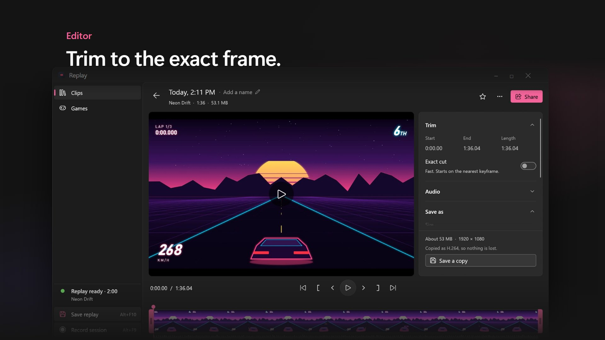

<div align="center">


# Replay

**Instant replay for Windows games. Save the play after it happens.**

[](https://github.com/Car-Role/replay/releases/latest)
[](https://github.com/Car-Role/replay/actions/workflows/ci.yml)
[](LICENSE)

[**Download**](https://car-role.github.io/replay/) · [Releases](https://github.com/Car-Role/replay/releases) · [Report a problem](https://github.com/Car-Role/replay/issues)

<a href="https://car-role.github.io/replay/"></a>

<sub>▶ <a href="https://car-role.github.io/replay/">Watch the 32-second tour</a></sub>

</div>

Replay keeps the last minutes of every game in memory, encoded by your graphics card. Press <kbd>Alt</kbd>+<kbd>F10</kbd> and the clip is saved. No account, no tracking, almost no performance cost.

## Features

- **Always ready.** A replay buffer for every game it finds, and full session recording with <kbd>Alt</kbd>+<kbd>F9</kbd>.
- **Finds your games.** Launchers, game folders, the Game Bar list and fullscreen apps. Several at once, each with its own quality.
- **Clean audio.** Game sound only (no Discord or music), your mic on its own track, and a mix. Turn on **Voice chat** to add Discord on a track of its own.
- **Edit fast.** Filmstrip trimming, exact-frame cuts, joins, volume per track, montages with music.
- **Share anywhere.** Copies sized for Discord, vertical 9:16, or a link from Streamable, Catbox, Litterbox or a ShareX uploader.
- **Light.** AV1, HEVC or H.264 on NVIDIA, AMD and Intel encoders. Webcam overlay, HDR to SDR, storage limits.

## Install

Get **Replay-Setup-windows-x64.exe** from the [download page](https://car-role.github.io/replay/). It needs no admin rights, and signed updates install in the background.

Requires Windows 10 (2004) or 11 and a GPU with a hardware video encoder. AV1 needs an NVIDIA RTX 40, AMD RX 7000 or Intel Arc GPU, or newer.

| Keys | Action |
|---|---|
| <kbd>Alt</kbd>+<kbd>F10</kbd> | Save a replay of the game in front |
| <kbd>Alt</kbd>+<kbd>Shift</kbd>+<kbd>F10</kbd> | Save every game |
| <kbd>Alt</kbd>+<kbd>F9</kbd> | Start or stop a session recording |
| <kbd>Ctrl</kbd>+<kbd>Alt</kbd>+<kbd>F10</kbd> | Mark the app in front as a game |

The NVIDIA app also uses <kbd>Alt</kbd>+<kbd>F10</kbd>: turn off its Instant Replay, or change the keys in Settings.

## Performance

| RTX GPU, AV1 1080p60, 25 Mbit/s | CPU | Memory |
|---|---|---|
| No game running | 0 | 3 MB |
| Recording, game audio and mic | ~5% of one core | ~115 MB + buffer |
| Saving a 2-minute clip | 0.3 s | shared with the buffer |

The buffer holds compressed video only: 2 minutes at 25 Mbit/s is about 375 MB per game.

## Build

```bash
cargo build --release
cargo test
```

Needs Rust 1.88+ and the MSVC build tools. The showcase video lives in [`video/`](video/) (Remotion).

<details>
<summary>Command line</summary>

| Command | Action |
|---|---|
| `replay` | Start the recorder (a second start opens the library) |
| `replay --library [clip]` | Open the library |
| `replay --save` / `--save-all` / `--record` | Control the running recorder (Stream Deck, macros) |
| `replay --trim <file> <a> <b>` | Fast trim |
| `replay --join <files>... [--music <file>]` | Join clips |
| `replay --export <file> <a> <b> [--size MB] [--vertical 0..1] [--codec h264]` | Re-encode: exact cut, size target, vertical crop |
| `replay --detect` / `--probe` | Show detected games / GPU, encoders and devices |
| `replay --selftest [s] [--webcam] [--hdr]` | Record the screen and check the result |
| `replay --snapshot [dir] [--scale 1.5]` | Render every library page to PNG, off-screen |
| `replay --check-update` | Download and verify the newest release |

Set `REPLAY_HOME` to keep settings and data in another folder (demos and tests).

</details>

<details>
<summary>How it works</summary>

```
game window ─WGC─▶ texture ─D3D11 video processor─▶ NV12 ─GPU encoder─▶ packet ring
game process ─WASAPI loopback─▶ AAC ─▶ packet ring
microphone ─WASAPI─▶ AAC ─▶ packet ring
hotkey ─▶ snapshot of the rings (no copy) ─▶ MP4 writer ─▶ Videos\Replay\<Game>\
```

Frames never leave the GPU. The ring drops whole GOPs, so every clip starts on a keyframe. The library is a separate process, so the recorder never loads UI code. Settings live in `%APPDATA%\Replay\config.toml`, logs in `%LOCALAPPDATA%\Replay\`.

</details>

<details>
<summary>Known limits</summary>

- Some games in exclusive fullscreen give no window frames; Replay records their monitor instead.
- Fast trims start on the keyframe before the cut; turn on **Exact cut** for frame accuracy.
- A session recording cut off by a crash cannot be played (its index is written at the end).
- HDR conversion and the upload services are not yet tested on real HDR displays or live accounts.
- macOS and Linux versions are paused.

</details>

## License

MIT
